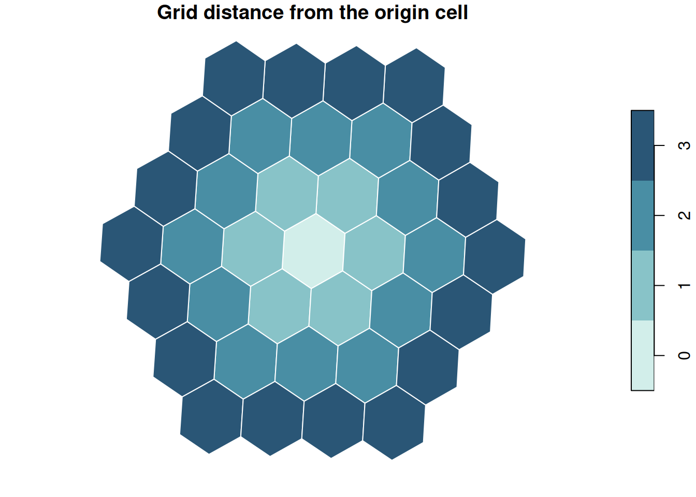
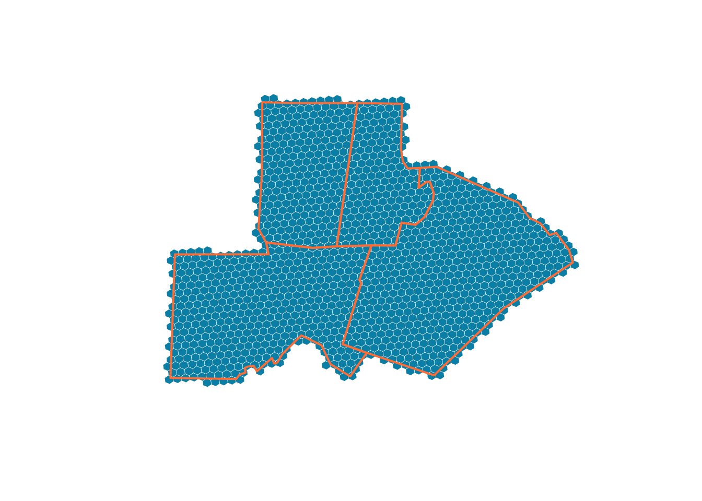

# Getting started

## Getting started

**{duckh3}** provides fast, memory-efficient functions for working with
the [H3 hierarchical indexing system](https://h3geo.org/) in R. It wraps
the [DuckDB H3 community
extension](https://duckdb.org/community_extensions/extensions/h3) and
integrates with **{duckspatial}**, **{dplyr}** and **{sf}**, so you can
index, aggregate and analyse large datasets with DuckDB while staying in
your usual R workflow.

H3 divides the globe into hexagonal cells at 16 resolutions (0 to 15).
Each cell has a unique 64-bit index, and every cell has one parent at a
coarser resolution and several children at finer ones. That makes H3
useful for spatial binning, joins and neighbourhood analysis without
needing any geometry at all.

Let’s start by loading the packages we need:

``` r

library(duckh3)
library(duckspatial)
library(dplyr)
library(sf)
```

## Installation

Install the stable release from CRAN:

``` r

# install.packages("pak")
pak::pak("duckh3")
```

Or the latest GitHub version:

``` r

pak::pak("Cidree/duckh3")
```

## Setting up a connection

Every {duckh3} function runs inside a DuckDB connection with the `h3`
and `spatial` extensions loaded. Before using the package, create the
**default connection** with
[`ddbh3_default_conn()`](https://cidree.github.io/duckh3/reference/ddbh3_default_conn.md).
It installs and loads the extensions (the first time it downloads them),
registers the {duckh3} SQL macros, and stores the connection so other
functions can find it:

``` r

ddbh3_default_conn(threads = 1)
```

The default connection is shared with {duckspatial}, so both packages
operate on the same database. If you want a separate database (for
example, a file on disk), create your own connection with
[`ddbh3_create_conn()`](https://cidree.github.io/duckh3/reference/ddbh3_create_conn.md)
and pass it through the `conn` argument:

``` r

conn <- ddbh3_create_conn(threads = 1)
```

> **Note**
>
> H3 indexes are unsigned 64-bit integers. {duckh3} connections use
> `bigint = "integer64"` so these values are never rounded. If you make
> a connection yourself with `duckdb::dbConnect()`, set
> `bigint = "integer64"` too, or store indexes as strings.

## Naming conventions

All functions start with `ddbh3_` (*DuckDB H3*), and the name says what
they take and what they return:

| Pattern | Description |
|----|----|
| `ddbh3_lonlat_to_*()` | From longitude/latitude columns |
| `ddbh3_points_to_*()` | From spatial point geometries |
| `ddbh3_polygons_to_*()`, `ddbh3_lines_to_*()` | From polygons or lines (polyfill) |
| `ddbh3_h3_to_*()` | From H3 cells to other representations |
| `ddbh3_vertex_to_*()`, `ddbh3_edge_to_*()` | From H3 vertexes and directed edges |
| `ddbh3_get_*()` | Get a property of a cell (resolution, parent, area…) |
| `ddbh3_is_*()` | Check a property of an index (valid, pentagon…) |

The suffix gives the output: `*_to_h3()` returns an H3 index,
`*_to_spatial()` returns hexagon geometries, and `*_to_lon()` /
`*_to_lat()` return the coordinates of the cell centre.

## From coordinates to H3 cells

H3 does not need spatial data. Any table with longitude and latitude
columns is a valid input. {duckh3} ships a small example dataset of 100
points:

``` r

points_tbl <- read.csv(
  system.file("extdata/example_pts.csv", package = "duckh3"),
  row.names = 1
)

head(points_tbl)
#>   id       lat        lon category
#> 1  1 -43.06925  16.192548        B
#> 2  2  29.18512  61.932969        C
#> 3  3 -20.68259  51.259176        C
#> 4  4  50.85681 -14.043806        B
#> 5  5 -57.62037   8.706529        C
#> 6  6 -56.21054  21.491229        B
```

[`ddbh3_lonlat_to_h3()`](https://cidree.github.io/duckh3/reference/ddbh3_lonlat_to.md)
adds a column with the H3 index of the cell that contains each point.
Columns are called `lon` and `lat` by default; use the `lon` and `lat`
arguments if yours have other names.

``` r

points_h3 <- ddbh3_lonlat_to_h3(points_tbl, resolution = 5)
points_h3
#> # A query:  ?? x 5
#> # Database: DuckDB 2.0.1 [unknown@Linux 7.0.0-1020-azure:R 4.6.2/:memory:]
#>       id    lat    lon category h3string       
#>    <int>  <dbl>  <dbl> <chr>    <chr>          
#>  1     1 -43.1   16.2  B        85d02dcffffffff
#>  2     2  29.2   61.9  C        854221affffffff
#>  3     3 -20.7   51.3  C        85a20e8bfffffff
#>  4     4  50.9  -14.0  B        85181c6ffffffff
#>  5     5 -57.6    8.71 C        85e6cecffffffff
#>  6     6 -56.2   21.5  B        85e69d23fffffff
#>  7     7 -33.7  -17.0  C        85c18807fffffff
#>  8     8 -32.7  -31.9  A        85c52b37fffffff
#>  9     9  -7.39  39.0  C        857b6b57fffffff
#> 10    10  10.0  -89.9  A        856d424bfffffff
#> # ℹ more rows
```

The result is a **lazy table**: the query has been defined in DuckDB,
but no data has been brought into R. This lets you chain several
operations and have DuckDB optimise them together. Use
[`collect()`](https://dplyr.tidyverse.org/reference/compute.html) (or
[`dplyr::pull()`](https://dplyr.tidyverse.org/reference/pull.html),
[`as.data.frame()`](https://rdrr.io/r/base/as.data.frame.html)…) when
you need the data in memory:

``` r

points_h3 |>
  collect() |>
  head()
#> # A tibble: 6 × 5
#>      id   lat    lon category h3string       
#>   <int> <dbl>  <dbl> <chr>    <chr>          
#> 1     1 -43.1  16.2  B        85d02dcffffffff
#> 2     2  29.2  61.9  C        854221affffffff
#> 3     3 -20.7  51.3  C        85a20e8bfffffff
#> 4     4  50.9 -14.0  B        85181c6ffffffff
#> 5     5 -57.6   8.71 C        85e6cecffffffff
#> 6     6 -56.2  21.5  B        85e69d23fffffff
```

By default indexes are returned as strings (`h3string`). You can request
the `UBIGINT` form instead, which is faster and smaller, and convert
between both formats at any time:

``` r

points_bigint <- ddbh3_lonlat_to_h3(
  points_tbl,
  resolution = 5,
  new_column = "h3bigint",
  h3_format  = "bigint"
)

points_bigint |>
  ddbh3_bigint_to_strings(h3 = "h3bigint") |>
  select(id, h3bigint, h3string) |>
  collect() |>
  mutate(h3bigint = as.character(h3bigint))
#> # A tibble: 100 × 3
#>       id h3bigint           h3string       
#>    <int> <chr>              <chr>          
#>  1     1 602641073348542463 85d02dcffffffff
#>  2     2 600142149706579967 854221affffffff
#>  3     3 601829684233109503 85a20e8bfffffff
#>  4     4 599402917115461631 85181c6ffffffff
#>  5     5 603039165277274111 85e6cecffffffff
#>  6     6 603035751852015615 85e69d23fffffff
#>  7     7 602383390343167999 85c18807fffffff
#>  8     8 602447381060911103 85c52b37fffffff
#>  9     9 601149965930070015 857b6b57fffffff
#> 10    10 600900854605676543 856d424bfffffff
#> # ℹ 90 more rows
```

## Vectorized mode

When you pass a plain character vector instead of a table (and leave
`conn = NULL`), {duckh3} works like a regular vectorised R function and
returns a vector:

``` r

cells <- c("85283473fffffff", "8928308280fffff", "not-an-index")

ddbh3_is_h3(cells)
#> [1]  TRUE  TRUE FALSE

ddbh3_get_resolution(cells[1:2])
#> [1] 5 9
```

This is handy for quick checks. Note that numeric vectors are rejected
because doubles cannot store every H3 index exactly; use character
strings or
[`bit64::integer64`](https://bit64.r-lib.org/reference/bit64-package.html)
instead.

## Output types

Functions that return geometries, like
[`ddbh3_h3_to_spatial()`](https://cidree.github.io/duckh3/reference/ddbh3_h3_to.md),
return a `duckspatial_df` by default: a lazy table with a geometry
column that {duckspatial} functions understand.

``` r

hex_ddbs <- ddbh3_h3_to_spatial(points_h3)
class(hex_ddbs)
#> [1] "duckspatial_df"        "tbl_duckdb_connection" "tbl_dbi"              
#> [4] "tbl_sql"               "tbl_lazy"              "tbl"
```

Use `mode = "sf"` to get an `sf` object directly. You can also change
the default for the whole session with
`duckspatial::ddbs_options(mode = "sf")`.

``` r

hex_sf <- ddbh3_h3_to_spatial(points_h3, mode = "sf")
hex_sf
#> Simple feature collection with 100 features and 5 fields
#> Geometry type: POLYGON
#> Dimension:     XY
#> Bounding box:  xmin: -97.98352 ymin: -60.07585 xmax: 94.87904 ymax: 59.9724
#> Geodetic CRS:  WGS 84
#> First 10 features:
#>    id        lat        lon category        h3string
#> 1   1 -43.069252  16.192548        B 85d02dcffffffff
#> 2   2  29.185117  61.932969        C 854221affffffff
#> 3   3 -20.682592  51.259176        C 85a20e8bfffffff
#> 4   4  50.856814 -14.043806        B 85181c6ffffffff
#> 5   5 -57.620368   8.706529        C 85e6cecffffffff
#> 6   6 -56.210542  21.491229        B 85e69d23fffffff
#> 7   7 -33.702164 -17.008820        C 85c18807fffffff
#> 8   8 -32.718974 -31.879051        A 85c52b37fffffff
#> 9   9  -7.388245  39.031393        C 857b6b57fffffff
#> 10 10  10.011989 -89.915075        A 856d424bfffffff
#>                          geometry
#> 1  POLYGON ((16.06751 -43.0320...
#> 2  POLYGON ((61.85553 29.20021...
#> 3  POLYGON ((51.1028 -20.67532...
#> 4  POLYGON ((-14.14365 51.0060...
#> 5  POLYGON ((8.82639 -57.58741...
#> 6  POLYGON ((21.54471 -56.2418...
#> 7  POLYGON ((-17.049 -33.68473...
#> 8  POLYGON ((-31.98893 -32.672...
#> 9  POLYGON ((39.0542 -7.415297...
#> 10 POLYGON ((-89.9927 10.07348...
```

Finally, any function can write its result to a table in a DuckDB
connection with the `name` argument, instead of returning it. Here we
store the points in our own connection, then index the table by name:

``` r

DBI::dbWriteTable(conn, "points", points_tbl)

ddbh3_lonlat_to_h3(
  "points",
  resolution = 7,
  conn       = conn,
  name       = "points_h3"
)
#> ✔ Query successful

DBI::dbListTables(conn)
#> [1] "points"    "points_h3"
```

## Using {duckh3} inside `mutate()`

{duckh3} registers DuckDB **macros** with the same names as the R
functions. On lazy tables you can call them directly inside
[`dplyr::mutate()`](https://dplyr.tidyverse.org/reference/mutate.html),
[`filter()`](https://dplyr.tidyverse.org/reference/filter.html) or
[`summarise()`](https://dplyr.tidyverse.org/reference/summarise.html),
and {dbplyr} sends them to DuckDB as SQL. This makes long pipelines very
concise:

``` r

points_lazy <- dplyr::copy_to(
  duckspatial::ddbs_default_conn(),
  points_tbl,
  name = "points_lazy",
  overwrite = TRUE
)

points_lazy |>
  mutate(
    h3       = ddbh3_lonlat_to_h3(lon, lat, 6),
    h3parent = ddbh3_get_parent(h3, 2),
    area_km2 = ddbh3_get_area(h3) / 1e6
  ) |>
  select(id, h3, h3parent, area_km2)
#> # A query:  ?? x 4
#> # Database: DuckDB 2.0.1 [unknown@Linux 7.0.0-1020-azure:R 4.6.2/:memory:]
#>       id h3              h3parent        area_km2
#>    <int> <chr>           <chr>              <dbl>
#>  1     1 86d02dcc7ffffff 82d02ffffffffff     34.4
#>  2     2 864221ac7ffffff 824227fffffffff     37.2
#>  3     3 86a20e8f7ffffff 82a20ffffffffff     36.7
#>  4     4 86181c6cfffffff 82181ffffffffff     37.1
#>  5     5 86e6cece7ffffff 82e6cffffffffff     33.6
#>  6     6 86e69d237ffffff 82e69ffffffffff     30.0
#>  7     7 86c188077ffffff 82c18ffffffffff     43.0
#>  8     8 86c52b36fffffff 82c52ffffffffff     37.7
#>  9     9 867b6b577ffffff 827b6ffffffffff     41.0
#> 10    10 866d424afffffff 826d47fffffffff     35.6
#> # ℹ more rows
```

> **Warning**
>
> Macros only exist inside DuckDB, so they work on lazy tables
> (`tbl_duckdb_connection`, `duckspatial_df`), not on regular data
> frames. For data frames, use the exported R functions.

## Hierarchy

Each H3 cell has one parent at every coarser resolution and many
children at every finer resolution. Moving up the hierarchy is a quick
way to aggregate data:

``` r

points_h3 |>
  ddbh3_get_parent(resolution = 1) |>
  count(h3parent, sort = TRUE)
#> # A query:    ?? x 2
#> # Database:   DuckDB 2.0.1 [unknown@Linux 7.0.0-1020-azure:R 4.6.2/:memory:]
#> # Ordered by: desc(n)
#>    h3parent              n
#>    <chr>           <int64>
#>  1 818e7ffffffffff       3
#>  2 81a23ffffffffff       2
#>  3 81defffffffffff       2
#>  4 81537ffffffffff       2
#>  5 81ccfffffffffff       2
#>  6 81193ffffffffff       2
#>  7 813b7ffffffffff       2
#>  8 81e6fffffffffff       2
#>  9 810e3ffffffffff       2
#> 10 81423ffffffffff       1
#> # ℹ more rows
```

Moving down returns several cells per input. By default the result is
unnested (one row per child); use `nested = TRUE` to keep a list column
instead:

``` r

points_h3 |>
  head(1) |>
  ddbh3_get_children(resolution = 6) |>
  select(id, h3string, h3children)
#> # A query:  ?? x 3
#> # Database: DuckDB 2.0.1 [unknown@Linux 7.0.0-1020-azure:R 4.6.2/:memory:]
#>      id h3string        h3children     
#>   <int> <chr>           <chr>          
#> 1     1 85d02dcffffffff 86d02dcc7ffffff
#> 2     1 85d02dcffffffff 86d02dccfffffff
#> 3     1 85d02dcffffffff 86d02dcd7ffffff
#> 4     1 85d02dcffffffff 86d02dcdfffffff
#> 5     1 85d02dcffffffff 86d02dce7ffffff
#> 6     1 85d02dcffffffff 86d02dcefffffff
#> 7     1 85d02dcffffffff 86d02dcf7ffffff
```

[`ddbh3_compact()`](https://cidree.github.io/duckh3/reference/ddbh3_compact.md)
does the reverse: it replaces each complete set of children with their
parent, which is a compact way to store large areas.
[`ddbh3_uncompact()`](https://cidree.github.io/duckh3/reference/ddbh3_compact.md)
expands them back to a single resolution.

## Neighbours and distances

[`ddbh3_grid_disk()`](https://cidree.github.io/duckh3/reference/ddbh3_grid_disk.md)
returns every cell within `k` steps of a cell (the “k-ring”), one row
per neighbour.
[`ddbh3_grid_distance()`](https://cidree.github.io/duckh3/reference/ddbh3_grid_distance.md)
then gives the number of steps between two cells. Combined with
[`ddbh3_h3_to_spatial()`](https://cidree.github.io/duckh3/reference/ddbh3_h3_to.md),
we can map how far each neighbour is from the origin:

``` r

disk <- points_h3 |>
  head(1) |>
  ddbh3_grid_disk(k = 3) |>
  ddbh3_grid_distance(h3start = "h3string", h3end = "h3neighbors") |>
  ddbh3_h3_to_spatial(h3 = "h3neighbors", mode = "sf")

plot(
  disk["grid_distance"],
  pal    = hcl.colors(4, "Teal", rev = TRUE),
  border = "white",
  main   = "Grid distance from the origin cell"
)
```



Grid distances can only be computed between cells that are reasonably
close; for cells too far apart the result is `NA`.

Cell size varies with latitude, so H3 cells of the same resolution do
not all have the same area.
[`ddbh3_get_area()`](https://cidree.github.io/duckh3/reference/ddbh3_get_area.md)
measures each cell, and
[`ddbh3_get_hexagon_area_avg()`](https://cidree.github.io/duckh3/reference/ddbh3_get_hexagon_avg.md)
gives the average area at a resolution:

``` r

points_h3 |>
  ddbh3_get_area(unit = "km^2") |>
  summarise(
    min_area  = min(h3area, na.rm = TRUE),
    mean_area = mean(h3area, na.rm = TRUE),
    max_area  = max(h3area, na.rm = TRUE)
  )
#> # A query:  ?? x 3
#> # Database: DuckDB 2.0.1 [unknown@Linux 7.0.0-1020-azure:R 4.6.2/:memory:]
#>   min_area mean_area max_area
#>      <dbl>     <dbl>    <dbl>
#> 1     158.      260.     305.

ddbh3_get_hexagon_area_avg(resolution = 5, unit = "km^2")
#> [1] 252.9039
```

## From polygons to H3 cells

[`ddbh3_polygons_to_h3()`](https://cidree.github.io/duckh3/reference/ddbh3_geom_to.md)
and
[`ddbh3_polygons_to_spatial()`](https://cidree.github.io/duckh3/reference/ddbh3_geom_to.md)
fill polygons with H3 cells (polyfill). They accept `sf` objects,
`duckspatial_df` objects or tables in a connection. Here we use the
North Carolina counties that ship with {sf}:

``` r

nc <- st_read(system.file("shape/nc.shp", package = "sf"), quiet = TRUE) |>
  st_transform(4326)

nc_subset <- nc[nc$NAME %in% c("Wake", "Durham", "Orange", "Chatham"), ]

nc_hex <- ddbh3_polygons_to_spatial(nc_subset, resolution = 7, mode = "sf")

plot(st_geometry(nc_hex), col = "#0A7EA4", border = "white", lwd = 0.3)
plot(st_geometry(nc_subset), border = "#FF6B35", lwd = 2, add = TRUE)
```



The `containment` argument controls which cells are kept: `"overlap"`
(default) keeps any cell that touches the polygon, while `"center"`
keeps only cells whose centre falls inside it. For lines, use
[`ddbh3_lines_to_h3()`](https://cidree.github.io/duckh3/reference/ddbh3_geom_to.md)
and
[`ddbh3_lines_to_spatial()`](https://cidree.github.io/duckh3/reference/ddbh3_geom_to.md).

## Learn more

This vignette covered the main building blocks. The [function
reference](https://cidree.github.io/duckh3/reference/index.html) lists
everything else, grouped by topic: vertexes, directed edges, local IJ
coordinates, icosahedron faces and more. For spatial operations on the
resulting hexagons (joins, areas, interpolation), see
[{duckspatial}](https://cidree.github.io/duckspatial/).
